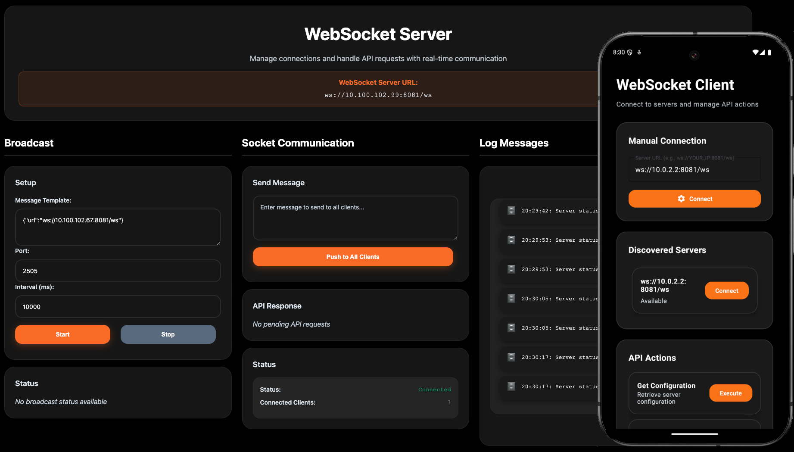

# WebSocket Mock Server



A simple Kotlin WebSocket server built with Ktor that provides a mock WebSocket endpoint for testing and development, with an Android example client.

## Features

- **WebSocket endpoint** at `/ws` for real-time bidirectional communication
- **Web dashboard** for managing connections, controlling broadcasts, and manipulating API responses
- **UDP broadcast discovery** - servers automatically advertise themselves on the local network
- **API request/response manipulation** - testers can control server responses through the dashboard
- **Automatic IP detection** - intelligently selects the best network interface (cross-platform)
- **Android example app** demonstrating WebSocket client usage with automatic server discovery
- **Network-agnostic design** - no hardcoded IP addresses required
- **Cross-platform support** - works on Windows, macOS, and Linux

## Prerequisites

### Server
- **Java JDK 11 or higher** (Required - Java 17 recommended)
  - ⚠️ **Important**: The server will NOT start with Java 8 or Java 9
  - 💡 **Having issues?** See [TROUBLESHOOTING.md](TROUBLESHOOTING.md) or [QUICK_FIX.md](QUICK_FIX.md)
- Bash-compatible shell (macOS/Linux) or PowerShell (Windows)

### Android Example (optional)
- Android Studio Hedgehog or newer
- Android SDK 34+
- USB-debuggable device or emulator

> ℹ️ Windows users should run `make` from PowerShell (`pwsh` or Windows Terminal) so the platform-specific script can launch.

## Quick Start

### 1. Start the WebSocket Server

#### Recommended: cross-platform `make` targets

```bash
make start
make stop
make restart
```

> **What these commands do:**
- `make start` → on macOS/Linux runs `start-server.sh`; on Windows runs `start-server.ps1`. Both free port 8081, start the server, and open your browser.
- `make stop` → invokes the matching platform routine to stop the Gradle process.
- `make restart` → stops first, waits 2 seconds, then starts again.

#### Alternatives
- macOS/Linux script: `./start-server.sh`
- Windows PowerShell: `.\start-server.ps1`
- Direct Gradle (no browser auto-open): `./gradlew :server:run`

### 2. Run the Android Example App

#### Option 1: Using Android Studio (Recommended)
1. Open the project in Android Studio
2. Wait for the project to sync and build
3. Select the `:examples:android` module in the run configuration dropdown
4. Choose your target device (emulator or physical device)
5. Click the "Run" button (green play icon) or press `Shift+F10`
6. The app will build and install on your device
7. The app will automatically discover and connect to the server

#### Option 2: Using Command Line
```bash
# Build and install the Android app
./gradlew :examples:android:installDebug

# Or run directly (requires connected device/emulator)
./gradlew :examples:android:run
```

#### Connection Configuration
- **Automatic Discovery**: The app automatically discovers servers on the network via UDP broadcast
- **Manual Connection**: You can manually enter any WebSocket server URL
- **Emulator Support**: Automatically detects emulator environments and prefills the connection URL
- **Network Agnostic**: Works with any network configuration without hardcoded IPs

## Usage

### Web Dashboard

When you start the server, a web dashboard automatically opens at `http://localhost:8081`. The dashboard provides:

- **Server IP Detection**: Automatically detects and displays the server's network IP address
- **UDP Broadcast Control**: Start/stop UDP broadcasts for automatic server discovery
  - Configure broadcast message template (JSON format)
  - Set broadcast port (default: 2505)
  - Adjust broadcast interval (default: 10 seconds)
- **API Request/Response Management**: 
  - View incoming API requests from clients
  - Manipulate responses with custom data, success/error states
  - Test edge cases and error scenarios
- **Real-time Communication**: Send messages to all connected clients
- **Connection Monitoring**: View connected clients and connection status

### WebSocket Connection

Connect to the WebSocket endpoint at:
```
ws://localhost:8081/ws
```

Or use the detected network IP (shown in the dashboard):
```
ws://<detected-ip>:8081/ws
```

### Testing WebSocket

1. Open the browser to `http://localhost:8081` (dashboard opens automatically)
2. Use the dashboard to:
   - Start UDP broadcast for automatic discovery
   - Monitor API requests from clients
   - Manipulate server responses for testing
   - Send messages to all connected clients
3. Connect clients (Android app, browser, or custom clients) to test your WebSocket implementation

## Android Client

The Android companion app auto-discovers servers on your network, supports manual connections, and offers a modern Material Design 3 UI for interactive testing.

```bash
# Install debug build on a connected device/emulator
./gradlew :examples:android:installDebug

# Optional: run straight from Gradle
./gradlew :examples:android:run
```

- Automatic UDP discovery locates servers and reports their status.
- Emulator detection pre-fills the loopback URL (`ws://10.0.2.2:8081/ws`).
- Manual mode lets you target any WebSocket endpoint.

## Project Structure

```
websocket-mock-server/
├── server/                    # WebSocket server module
│   ├── src/main/kotlin/com/websocketmockserver/
│   │   ├── MockServer.kt      # Main server application
│   │   ├── services/         # Server services
│   │   │   ├── BroadcastService.kt      # UDP broadcast management
│   │   │   └── WebSocketSessionService.kt  # WebSocket session handling
│   │   └── util/
│   │       └── NetworkUtils.kt  # Network IP detection
│   └── src/main/resources/
│       └── static/            # Web dashboard files
│           ├── websocket-server-dashboard.html
│           ├── websocket-server-dashboard.js
│           └── websocket-server-dashboard.css
├── examples/
│   └── android/              # Android example app
│       ├── src/main/java/com/example/websocketclient/
│       │   ├── MainActivity.kt
│       │   ├── MainViewModel.kt
│       │   ├── MessagesAdapter.kt
│       │   ├── ServerDiscovery.kt      # UDP discovery implementation
│       │   ├── DynamicApiClient.kt     # API request/response handling
│       │   └── WebSocketMessage.kt
│       └── src/main/res/     # Android resources
├── build.gradle.kts          # Root build configuration
├── Makefile                  # Convenient commands (make start/stop)
├── start-server.sh           # Auto-start script (macOS/Linux)
├── start-server.ps1          # Auto-start script (Windows PowerShell)
└── README.md                 # This file
```

## Stopping the Server

- `make stop` (cross-platform)
- Press `Ctrl+C` in the terminal that launched the server
- If the port is wedged: `lsof -ti:8081 | xargs kill -9` (macOS/Linux)

## Development

### Quick Commands
```bash
# Build the project
make build

# Clean build artifacts
make clean

# Show all available commands
make help
```

### Building with Gradle
```bash
# Build everything
./gradlew build

# Build server only
./gradlew :server:build

# Build Android app only
./gradlew :examples:android:build
```

## Configuration

### Server Port

The server runs on port 8081 by default. You can change this in `server/src/main/kotlin/com/websocketmockserver/MockServer.kt`:

```kotlin
private const val SERVER_PORT = 8081
```

### UDP Broadcast Discovery

- **Default broadcast port**: 2505
- **Default broadcast interval**: 10 seconds (10000ms)
- **Default broadcast message**: JSON format with WebSocket URL

The broadcast message template can be customized in the web dashboard. The server automatically detects its network IP address and can update the broadcast message accordingly.

### IP Detection

The server uses intelligent IP detection that:
- Filters out virtual interfaces (Docker, VMs, VPNs)
- Prioritizes real network interfaces
- Prefers `10.x.x.x` ranges over `192.168.64.x` (Docker Desktop)
- Works cross-platform (Windows, macOS, Linux)

The detected IP is displayed in the web dashboard and can be used for UDP broadcasts.

## Troubleshooting

### Dashboard Not Showing / Server Won't Start

**Problem**: Server crashes with exit code `-1073741510` or times out  
**Cause**: Java version too old (Java 8 or 9 installed)  
**Solution**: Install Java 17

**Quick Fix (Windows):**
```powershell
# 1. Install Java 17
winget install Microsoft.OpenJDK.17 --accept-source-agreements --accept-package-agreements

# 2. Find your Java installation path
Get-ChildItem "C:\Program Files\Microsoft\jdk-*" -Directory | Select-Object FullName

# 3. Set JAVA_HOME (replace with YOUR path from step 2)
$env:JAVA_HOME = "YOUR_JAVA_PATH_HERE"
$env:PATH = "$env:JAVA_HOME\bin;$env:PATH"

# 4. Start server
.\gradlew.bat :server:run
```

📖 **Full guide**: See [TROUBLESHOOTING.md](TROUBLESHOOTING.md) for detailed instructions  
⚡ **Quick reference**: See [QUICK_FIX.md](QUICK_FIX.md) for the fastest solution

### Other Common Issues

- **Port 8081 already in use**: Run `make stop` or manually kill the process
- **JAVA_HOME not set**: Set it manually or run the server with explicit Java path
- **Gradle build fails**: Ensure internet connection for dependency downloads

## Dependencies

### Server
- **Ktor Server Core**: Web framework
- **Ktor Server Netty**: Netty engine
- **Ktor WebSockets**: WebSocket support
- **Ktor HTML Builder**: HTML templating
- **Logback**: Logging framework

### Android Example
- **OkHttp**: WebSocket client
- **AndroidX**: Modern Android components
- **Material Design**: UI components 